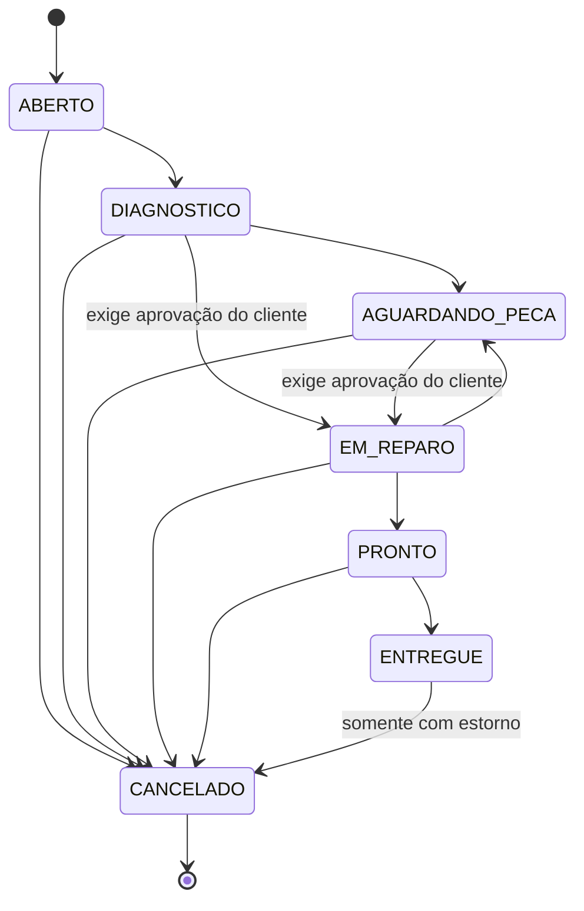

[README.md](https://github.com/user-attachments/files/34721507/README.md)
# KF Imports - Dicionário de Dados

**Sistema de Gestão Operacional, Vendas e Assistência Técnica**

Documentação de governança de dados do banco `assistencia_tecnica` (MySQL 8.4 LTS), publicada como um dicionário de dados interativo.

> **Acesse o dicionário online:** [https://v-arruda.github.io/Dicion-rio--dados-KF-imports/](https://v-arruda.github.io/Dicion-rio--dados-KF-imports/)

| | |
|---|---|
| Empresa | KF Imports |
| Projeto | Sistema de Gestão Operacional, Vendas e Assistência Técnica |
| Instituição | UNICID - Universidade Cidade de São Paulo (Tatuapé) |
| Curso e disciplina | Ciência da Computação - Modelagem de Banco de Dados |
| Professor orientador | Diego Marques de Carvalho |
| Equipe | Grupo 2D1 |
| SGBD | MySQL 8.4 LTS (InnoDB, utf8mb4, utf8mb4_0900_ai_ci) |

---

## Sumário

1. [Sobre a KF Imports](#1-sobre-a-kf-imports)
2. [O problema que o banco de dados resolve](#2-o-problema-que-o-banco-de-dados-resolve)
3. [Para que serve o banco de dados](#3-para-que-serve-o-banco-de-dados)
4. [Como a loja funciona na prática](#4-como-a-loja-funciona-na-prática)
5. [Quem usa o sistema](#5-quem-usa-o-sistema)
6. [Regras de negócio que o banco protege](#6-regras-de-negócio-que-o-banco-protege)
7. [Modelo de dados](#7-modelo-de-dados)
8. [Conformidade legal e privacidade](#8-conformidade-legal-e-privacidade)
9. [Segurança, desempenho e continuidade](#9-segurança-desempenho-e-continuidade)
10. [O que está dentro e fora do escopo](#10-o-que-está-dentro-e-fora-do-escopo)
11. [O dicionário de dados interativo](#11-o-dicionário-de-dados-interativo)
12. [Estrutura do repositório](#12-estrutura-do-repositório)
13. [Como executar localmente e publicar](#13-como-executar-localmente-e-publicar)
14. [Equipe e responsabilidades](#14-equipe-e-responsabilidades)

---

## 1. Sobre a KF Imports

A **KF Imports** é uma microempresa com **loja física única em São Paulo/SP**. Ela atua em duas frentes que se complementam:

- **Varejo de acessórios de telefonia:** capas, películas, cabos e itens semelhantes, vendidos no balcão.
- **Assistência técnica de smartphones:** o cliente deixa o aparelho com defeito, a loja faz o diagnóstico, apresenta o orçamento, executa o reparo com peças de reposição (telas, baterias e outras) e entrega o aparelho com garantia.

O estoque da loja é reposto por **compras presenciais no Brás**, bairro de São Paulo conhecido pela concentração de atacadistas de eletrônicos e acessórios. Isso significa que a reposição depende de viagens de compra planejadas, e não de pedidos automáticos a um fornecedor.

A operação é conduzida por **quatro perfis de usuário** (Atendente, Técnico, Gerente e Administrador), com **um caixa aberto por operador**.

O representante do cliente neste projeto é **Kaique Vieira**, que atua como Data Owner das regras de negócio.

## 2. O problema que o banco de dados resolve

Antes deste projeto, o controle de Ordens de Serviço (OS) era manual. Três problemas de negócio guiaram toda a modelagem:

| Problema | Consequência para a loja | Como o banco resolve |
|---|---|---|
| **Perda de rastreabilidade do estoque** nas compras do Brás | Não se sabe o que entrou, quando e a que custo; falta ou excesso de produto | Toda compra gera movimentações imutáveis de estoque (`compra`, `item_compra`, `mov_estoque`) |
| **Ausência de controle transacional de caixa** | Diferenças de caixa sem explicação; venda sem pagamento correspondente | Caixa por operador, com abertura, suprimento, sangria e fechamento conferido (`caixa`, `mov_caixa`, `pagamento`) |
| **Peças usadas em OS sem vínculo com o saldo físico** | Peça aplicada no conserto que nunca sai do estoque; prejuízo invisível | Cada peça aplicada em uma OS baixa o estoque automaticamente e fica registrada (`item_os`, `mov_estoque`) |

O objetivo geral é **eliminar erros operacionais**, **otimizar as compras no Brás** e **garantir dados centralizados e íntegros**, em conformidade com a LGPD, o Código de Defesa do Consumidor e a guarda legal de registros comerciais.

## 3. Para que serve o banco de dados

O banco `assistencia_tecnica` é a **fonte única e confiável** de tudo o que acontece na loja. Ele sustenta os seguintes módulos:

| Módulo | O que entrega ao negócio |
|---|---|
| **Clientes e aparelhos** | Cadastro de clientes, endereços e aparelhos, com um ou dois IMEIs por aparelho |
| **Ordens de Serviço** | Abertura com comprovante de entrada (estado prévio do aparelho), orçamento, aprovação do cliente, fluxo de status da bancada e entrega |
| **Produtos e estoque** | Catálogo de acessórios e peças, preços de custo e venda, estoque mínimo e ideal, histórico de todas as movimentações |
| **Lista de compras do Brás** | Relatório automático dos itens abaixo do estoque mínimo, com a quantidade sugerida para a viagem de compras |
| **Fornecedores e compras** | Registro das compras presenciais com entrada automática no estoque |
| **Vendas de balcão** | Venda rápida com baixa imediata de estoque e uma ou mais formas de pagamento |
| **Controle de caixa** | Abertura, suprimentos, sangrias e fechamento diário com conferência de diferenças |
| **Estornos e garantia** | Estorno total de venda ou OS e consulta de garantia por CPF, número da OS ou IMEI |
| **Relatórios financeiros** | Faturamento, margem de lucro e separação entre receita de acessórios e de serviços técnicos |
| **Usuários e acesso** | Perfis com permissões diferentes por função |
| **Auditoria** | Trilha de todas as alterações relevantes, sem expor dados pessoais |
| **Privacidade (LGPD)** | Consentimento, revogação, solicitações do titular e anonimização |
| **Notificações** | Geração de link do WhatsApp com mensagem pronta, para envio manual em um clique |

**Valor para o negócio:** o dono passa a saber, com números confiáveis, quanto vendeu, quanto lucrou, o que precisa comprar, qual aparelho está em qual etapa e quem fez cada operação.

## 4. Como a loja funciona na prática

### Fluxo da assistência técnica

1. O **Atendente** recebe o aparelho, cadastra o cliente, registra marca, modelo, IMEI, defeito relatado e o **estado físico prévio** (para proteger a loja e o cliente contra disputas sobre avarias antigas). A OS é aberta com número único e comprovante.
2. O **Técnico** faz o diagnóstico e monta o **orçamento**.
3. O cliente **aprova o orçamento**. Sem essa aprovação, o banco não permite iniciar o reparo.
4. O Técnico executa o reparo e registra as **peças aplicadas**. O estoque é baixado automaticamente.
5. Quando o aparelho está pronto, a loja avisa o cliente pelo **WhatsApp** (somente se houver consentimento).
6. Na **entrega**, o pagamento deve cobrir o valor total da OS e o caixa deve estar aberto. A garantia legal de 90 dias começa a contar.



### Fluxo de vendas e caixa

1. O operador **abre o caixa** com o saldo inicial.
2. Cada **venda** é registrada em uma única transação: itens, baixa de estoque e pagamentos. Se qualquer parte falhar, nada é gravado.
3. Durante o dia, o operador registra **suprimentos** e **sangrias**.
4. No fim do expediente, o **fechamento** compara o valor contado pelo operador com o saldo apurado pelo sistema e aponta a diferença.

### Fluxo de compras no Brás

1. O Gerente consulta a **lista de compras**: produtos ativos com saldo igual ou abaixo do mínimo, com a quantidade sugerida (estoque ideal menos saldo atual).
2. Após a viagem, registra a **compra** com fornecedor, itens, custo unitário e comprovante.
3. O estoque é atualizado automaticamente e o custo de cada item fica congelado no histórico.

## 5. Quem usa o sistema

| Perfil | Responsabilidade principal | Pode | Não pode |
|---|---|---|---|
| **Atendente** | Balcão e recepção | Cadastrar clientes, abrir OS, vender, operar o próprio caixa, entregar aparelhos | Estornar, comprar, ver margens, gerenciar usuários |
| **Técnico** | Bancada | Diagnosticar, alterar status da OS até PRONTO, aplicar peças | Vender, entregar, estornar |
| **Gerente** | Gestão da loja | Tudo do Atendente, catálogo, fornecedores, compras, estornos, ajuste de inventário, fechar qualquer caixa | Gerenciar usuários |
| **Administrador** | Administração do sistema | Usuários e perfis, trilha de auditoria, relatórios | Excluir registros (ninguém pode) |

A matriz completa por tabela está na especificação de requisitos (seção 3.1) e na coluna de **Controle de Acesso** do dicionário.

## 6. Regras de negócio que o banco protege

As regras abaixo foram definidas com o representante da KF Imports e estão detalhadas na especificação.

| Regra | Em linguagem simples |
|---|---|
| **Trava de estoque** | Não se vende nem se aplica em OS produto sem saldo ou inativo |
| **Orçamento aprovado** | O reparo só começa depois que o cliente aprova o orçamento |
| **Máquina de estados da OS** | A OS só segue transições permitidas; qualquer outra é recusada |
| **Estoque controlado** | O saldo só muda por movimentações registradas (compra, venda, OS, estorno, ajuste) |
| **Caixa aberto obrigatório** | Sem caixa aberto do próprio operador não há venda, pagamento nem estorno em dinheiro; cada operador tem no máximo um caixa aberto |
| **Preço congelado** | O preço e o custo gravados na venda, na OS ou na compra não mudam depois, mesmo que o produto seja reajustado |
| **Estorno único e autorizado** | Cada venda ou OS admite um único estorno, total, feito por Gerente ou Administrador, com motivo de pelo menos 10 caracteres |
| **Conciliação de pagamento** | O total pago deve ser igual ao total da venda ou da OS |
| **Registros imutáveis** | Itens, pagamentos, movimentações, estornos e logs não podem ser alterados ou apagados |
| **Sem exclusão física** | Dados são inativados, nunca apagados; a anonimização de cliente é a única forma de remover dados pessoais |
| **Limite de desconto** | Desconto acima de 10% do item exige perfil Gerente ou Administrador (percentual sugerido, a validar com o cliente) |

## 7. Modelo de dados

O banco possui **22 tabelas** (21 de negócio e 1 de apoio), **164 colunas** e **36 chaves estrangeiras**, todas com `ON DELETE RESTRICT` e `ON UPDATE RESTRICT` para preservar o histórico financeiro. O modelo segue a Terceira Forma Normal, com exceções documentadas e justificadas na especificação (seção 6.2).

| Domínio | Tabelas |
|---|---|
| **Pessoas e acesso** | `usuario`, `cliente`, `endereco` |
| **Privacidade** | `consentimento_cliente`, `solicitacao_titular` |
| **Assistência técnica** | `aparelho`, `aparelho_imei`, `ordem_servico`, `item_os` |
| **Catálogo e compras** | `categoria`, `fornecedor`, `produto`, `compra`, `item_compra` |
| **Estoque** | `mov_estoque` |
| **Vendas e financeiro** | `venda`, `item_venda`, `pagamento`, `estorno` |
| **Caixa** | `caixa`, `mov_caixa` |
| **Auditoria** | `log_auditoria` |

O diagrama completo está em `assets/der.png` e pode ser aberto, com zoom e arraste, dentro do dicionário.

## 8. Conformidade legal e privacidade

O sistema foi desenhado para atender às obrigações que incidem sobre uma loja de varejo e assistência técnica:

| Norma | Como é atendida no banco |
|---|---|
| **LGPD (Lei 13.709/2018)** | Consentimento por finalidade com data e revogação; solicitações do titular com prazo de resposta de 15 dias; anonimização irreversível por procedimento controlado; log de auditoria sem dados pessoais em claro; senha de desbloqueio do aparelho cifrada e descartada após a entrega |
| **Código de Defesa do Consumidor (Lei 8.078/1990)** | Garantia legal de 90 dias para serviço e produto; orçamento prévio com aprovação; autorização do cliente para peças que não sejam novas e originais; comprovante com o estado prévio do aparelho |
| **Código Tributário Nacional (Lei 5.172/1966)** | Retenção de vendas, OS, pagamentos, estornos e compras por no mínimo 5 anos, sem exclusão física |

A emissão de documentos fiscais (NF-e/NFC-e) **não faz parte** deste banco: é responsabilidade de uma solução externa contratada pela KF Imports.

No dicionário de dados, cada coluna recebe uma etiqueta de privacidade:

| Etiqueta | Significado | Exemplos |
|---|---|---|
| **DPS** (vermelha) | Dado de alto risco, tratado como sensível | `senha_desbloqueio` |
| **DP** (amarela) | Dado pessoal | `cpf_cnpj`, `whatsapp`, `email`, endereço, `imei` |
| **N/A** (verde) | Não se aplica | Valores, quantidades, datas operacionais |

## 9. Segurança, desempenho e continuidade

| Tema | Diretriz |
|---|---|
| **Autenticação** | Senha com no mínimo 12 caracteres, armazenada com Argon2id; bloqueio de 15 minutos após 5 tentativas inválidas |
| **Autorização** | Privilégio mínimo por perfil (RBAC), com permissões por coluna |
| **Criptografia** | TLS 1.3 em trânsito; tablespaces e backups com AES-256 |
| **Auditoria** | 100% das operações de INSERT e UPDATE nas tabelas sensíveis, com usuário, data, IP e hash dos dados pessoais |
| **Integridade** | Transações atômicas (ACID, InnoDB); reexecução automática em caso de deadlock |
| **Desempenho** | Meta de 500 ms para consultas e relatórios e 2.000 ms para operações de escrita (P95), sobre a massa de referência de 5.000 produtos, 100.000 vendas, 300.000 itens de venda e 20.000 OS |
| **Disponibilidade** | 99,5% na janela de funcionamento da loja (segunda a sábado, 09:00 às 19:00) |
| **Backup** | Cópia do log binário a cada 15 minutos e backup completo diário; teste de restauração mensal |

## 10. O que está dentro e fora do escopo

**Dentro do escopo desta entrega:** schema, tabelas, constraints (chaves primárias e estrangeiras, UNIQUE e CHECK) e índices, descritos no script DDL, mais a especificação completa de requisitos e regras de negócio.

**Descrito, mas previsto para etapa posterior:** triggers, procedimentos armazenados, views, papéis de acesso e carga de dados de teste. Eles estão especificados nas seções 4 a 6 da especificação e listados como pendência no Anexo A.

**Fora do escopo do projeto:** vendas por canais digitais, folha de pagamento, contabilidade, emissão de NF-e/NFC-e, integração via API com fornecedores, impressoras fiscais e gavetas de dinheiro, multilojas, venda a prazo e parcelamento, devolução parcial de itens, contas a pagar e a receber, comissões e garantia contratual estendida.

## 11. O dicionário de dados interativo

A página `index.html` reúne a documentação das 22 tabelas e das 164 colunas, seguindo boas práticas de governança de dados (DAMA-DMBOK e COBIT).

Para cada coluna, o dicionário informa:

| Campo | Conteúdo |
|---|---|
| **Atributo** | Nome da coluna no banco |
| **Descrição e regra de negócio** | Para que serve e quais limites se aplicam |
| **Tipo e tamanho** | Exatamente como no script DDL |
| **Constraints** | PK, FK, UNIQUE, NULL, CHECK e outras, em destaque |
| **Privacidade** | Etiquetas DPS, DP e N/A |
| **Linhagem** | De onde o dado vem e para onde vai |
| **Controle de acesso** | Quais perfis podem criar, ler, atualizar ou inativar |

Recursos da página:

- Menu lateral com todas as tabelas, adaptado para celular.
- Busca em tempo real por nome de tabela ou de coluna.
- Alternância entre modo claro e modo escuro.
- Visualizador do DER em tela cheia, com zoom pela roda do mouse, arraste e botões de Zoom +, Zoom - e Reset.
- Download da especificação de requisitos em PDF.

## 12. Estrutura do repositório

```text
/
├── README.md
├── index.html
├── style.css
├── script.js
├── docs/
│   └── Especificacao_Requisitos_Regras_Negocio_BD.pdf
└── assets/
    └── der.png
```

Os nomes de arquivos e pastas devem ser mantidos exatamente assim, em minúsculas. O servidor do GitHub Pages diferencia maiúsculas de minúsculas.

## 13. Como executar localmente e publicar

**Localmente:** baixe o repositório e abra o `index.html` no navegador. É necessária conexão com a internet apenas para carregar a biblioteca Panzoom (zoom do DER).

**Publicação no GitHub Pages:**

1. Envie os arquivos para um repositório público.
2. Acesse **Settings > Pages > Build and deployment**.
3. Em **Source**, escolha **Deploy from a branch**; em **Branch**, escolha **main** e a pasta **/ (root)**; clique em **Save**.
4. Após alguns minutos, o site estará em `https://v-arruda.github.io/Dicion-rio--dados-KF-imports/`.

## 14. Equipe e responsabilidades

| Nome | RGM | Papel |
|---|---|---|
| Kaique Vieira | - | Data Owner (regras de negócio), representante da KF Imports |
| Guilherme Lima Araujo | 47058773 | Data Steward; líder do grupo e análise de requisitos |
| Diogo Cora | 47071974 | Data Steward; análise de negócio e regras |
| Arthur Henrique Alves | 47332361 | Data Steward; mapeamento de entidades e restrições |
| Giovanni Henrique Tartaro | 47048026 | Data Steward; mapeamento de entidades e restrições |
| Júlio César Rocha | 47422432 | Data Steward; revisão final e rastreabilidade |
| Vitor Arruda dos Santos | 47351241 | Data Steward; revisão final e rastreabilidade |

**Orientação acadêmica:** Prof. Diego Marques de Carvalho, UNICID - Ciência da Computação, disciplina de Modelagem de Banco de Dados.

---

*Projeto acadêmico desenvolvido para a KF Imports. Valores marcados como "a validar" na especificação (limite de desconto, prazos de estorno, alçadas de autorização) dependem de confirmação do representante do cliente e constam no Anexo A do documento.*
